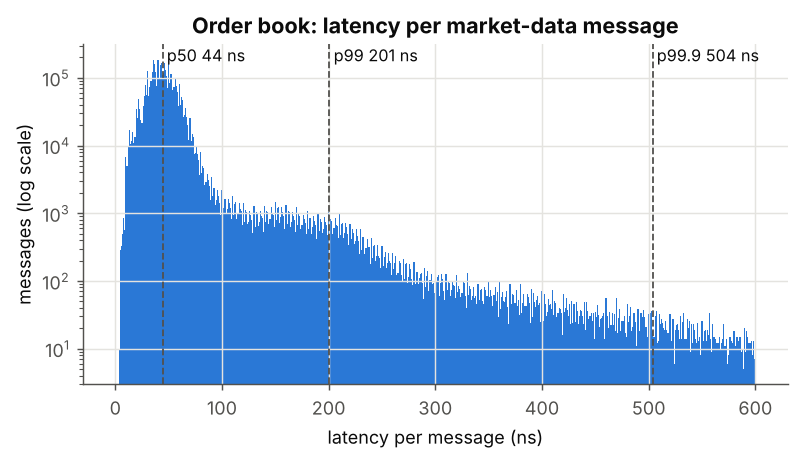
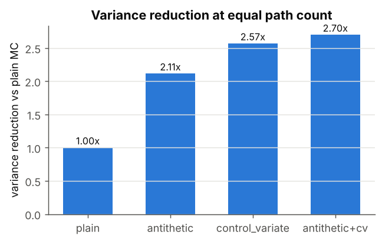
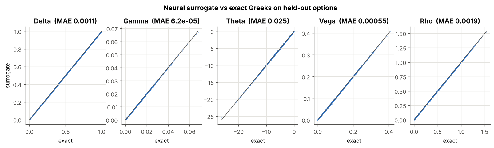
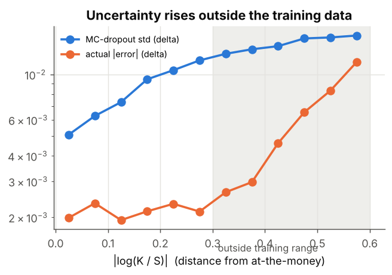

# QuantumFlow

**Real-time Heston option pricer with a lock-free C++ order book, a CUDA Monte Carlo engine, and a neural Greeks surrogate with calibrated uncertainty (about 100,000x faster than Monte Carlo bumping, batched).**

   <!-- add the CI badge once pushed:  -->

| Operation | Measured | Method |
|---|---|---|
| Order book update | **44 ns p50, 201 ns p99** | single writer, flat `alignas(64)` levels, AVX2 scan, pooled nodes |
| Order book throughput | **39 M msgs/s** (1 thread) | 5M-message synthetic feed |
| Best bid/ask read (other thread) | **2.4 ns** | seqlock, no locks |
| 10,000 Heston paths x 256 steps | **24 ms on 4 CPU cores**; GPU: *run `cuda_bench`* | CPU OpenMP / CUDA kernel |
| Greeks, surrogate | **6.1 µs per option** batched (504 µs single call) | PyTorch MLP, 4 CPU threads |
| Greeks, MC bump | 611 ms | 9 runs x 65,536 paths x 128 steps, CPU |
| Delta MAE | **0.0011** | 100K held-out options |
| 95% interval coverage (delta) | **95.2%** | MC dropout, 50 passes, calibrated |
| Analytic pricer vs QuantLib | **< 1e-6** | 5 cases, `AnalyticHestonEngine` |

Every number above was produced by the code in `benchmarks/` and `python/` on a 4-core cloud VM (no GPU) and is regenerated into `results/dashboard.html`. The GPU rows are filled by running `notebooks/colab_cuda.ipynb` on a free T4.

## Architecture

```
 market feed ──► order book (C++17) ──mid──► Monte Carlo engine (CPU / CUDA) ◄── analytic Heston (answer key)
                                                     │                                   │ exact labels
 ═════════════════════════ pybind11 bridge: qf_core, zero-copy NumPy ═══════════════════════════════════
                                                     ▼                                   ▼
 dashboard ◄── risk output (surrogate, MC fallback) ◄── neural surrogate (PyTorch) ◄── 500K training set
```

| Component | Files |
|---|---|
| A. Order book | `src/orderbook/` |
| B. Heston Monte Carlo | `src/cuda/`, `src/cpu/`, `src/common/` |
| C. Neural Greeks surrogate | `python/surrogate/` |
| D. pybind11 bridge | `src/bridge/pybind_module.cpp` |
| E. Benchmarks & dashboard | `benchmarks/`, `python/dashboard/`, `results/` |

## Quick start

```bash
pip install -r requirements.txt
./run_all.sh          # build, test, benchmark, generate data, train, plot
```

or step by step:

```bash
cmake -S . -B build -DCMAKE_BUILD_TYPE=Release   # uses nvcc automatically if present
cmake --build build -j
ctest --test-dir build --output-on-failure
python -m pytest tests/test_validation.py -q
./build/ob_latency_bench results && ./build/mc_cpu_bench results
./build/cuda_bench results                       # GPU machines only
python python/scripts/generate_training_data.py --n_samples 500000
python python/surrogate/train.py
python python/scripts/pipeline_demo.py
python python/dashboard/make_plots.py            # -> results/dashboard.html
```

## Results






**Variance reduction** (1M paths, equal path count): antithetic 2.1x, control variate 2.6x, both 2.7x.

**Surrogate test MAE**: delta 0.0011, gamma 0.00006, theta 0.025 /yr, vega 0.00055 /vol pt, rho 0.0019 /1%. R² above 0.9997 for all five.

**Out of distribution**: on options beyond the training ranges, delta error rises from 0.0015 to 0.0052 and the MC-dropout spread rises with it (0.008 to 0.013), which is the signal `pipeline_demo.py` uses to fall back to Monte Carlo.

## GPU profile (Nsight)

The CUDA kernel compiles for sm_61 / sm_75 / sm_86 (ptxas: 64 registers per thread with float paths, 94 with double). It has not been profiled yet; see `profiles/README.md` for the exact `nsys` / `ncu` commands and the metrics to report (occupancy, memory and compute throughput, roofline, L2 hit rate, warp efficiency), plus the block-size, float-vs-double and SoA-vs-AoS experiments already built into `cuda_bench`.

## Mathematical appendix

Heston under the risk-neutral measure:

$$dS_t = rS_t\,dt + \sqrt{v_t}\,S_t\,dW^1_t,\qquad dv_t = \kappa(\theta - v_t)\,dt + \xi\sqrt{v_t}\,dW^2_t,\qquad d\langle W^1,W^2\rangle_t = \rho\,dt$$

kappa: mean-reversion speed · theta: long-run variance · xi: vol of vol · rho: spot/vol correlation · v0: initial variance.

Discretisation (full truncation, Lord et al. 2010), with $v^+ = \max(v,0)$:

$$\ln S_{t+\Delta} = \ln S_t + (r - \tfrac12 v_t^+)\Delta + \sqrt{v_t^+\Delta}\,Z_1,\qquad v_{t+\Delta} = v_t + \kappa(\theta - v_t^+)\Delta + \xi\sqrt{v_t^+\Delta}\,(\rho Z_1 + \sqrt{1-\rho^2}Z_2)$$

Antithetic estimator: $\hat C = \frac1N\sum_i \tfrac12\big[f(Z^{(i)}) + f(-Z^{(i)})\big]$.

Control variate ($X$ = GBM payoff driven by the same $Z_1$ with the expected average Heston variance, $E[X]$ = Black-Scholes price):

$$\hat C_{cv} = \bar Y - \beta(\bar X - E[X]),\qquad \beta = \mathrm{Cov}(X,Y)/\mathrm{Var}(X)$$

Reference price (Lewis 2000, characteristic function in the Albrecher et al. 2007 form):

$$C = S_0 - \frac{\sqrt K e^{-rT}}{\pi}\int_0^\infty \mathrm{Re}\big[e^{-iu\ln K}\varphi(u - i/2)\big]\frac{du}{u^2+1/4}$$

## Validation

* `tests/test_heston.cpp`: Black-Scholes limit (price and all five Greeks), MC vs analytic within 4 standard errors, each variance-reduction step lowers the error, thread-count determinism, MC bump Greeks vs analytic.
* `tests/test_orderbook.cpp`: 200K random messages vs a `std::map` reference book after every message, price-time priority, SIMD scanner vs scalar, SPSC queue across threads, concurrent seqlock readers.
* `tests/test_validation.py`: analytic and Monte Carlo prices vs QuantLib, zero-copy bridge, order book through Python.

## Repository layout

```
src/common   heston_params.hpp heston_analytic.hpp heston_path.hpp philox.hpp mc_greeks.hpp
src/cpu      heston_mc_cpu.hpp
src/cuda     heston_mc.cu heston_mc.cuh variance_reduction.cuh curand_wrapper.cuh
src/orderbook order_book.hpp simd_scanner.hpp memory_pool.hpp spsc_queue.hpp feed_simulator.hpp
src/bridge   pybind_module.cpp
python/      surrogate/{model,train,uncertainty}.py scripts/{generate_training_data,pipeline_demo}.py dashboard/make_plots.py
benchmarks/  ob_latency_bench.cpp mc_cpu_bench.cpp cuda_bench.cpp
tests/       test_orderbook.cpp test_heston.cpp test_validation.py
notebooks/   bridge_demo.ipynb colab_cuda.ipynb
configs/ results/ models/ profiles/
```
